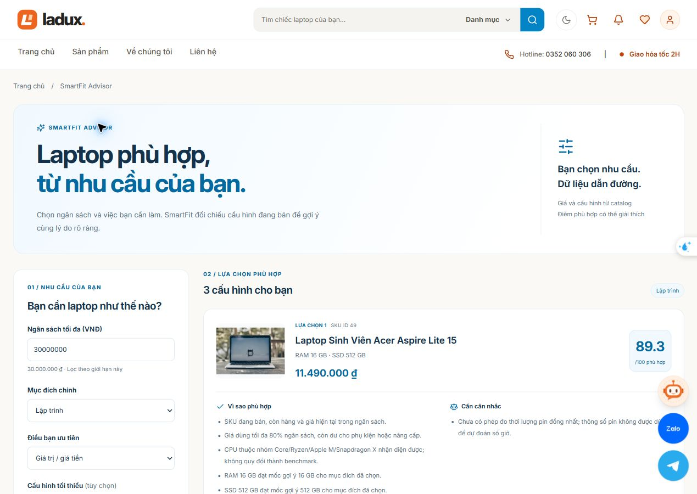
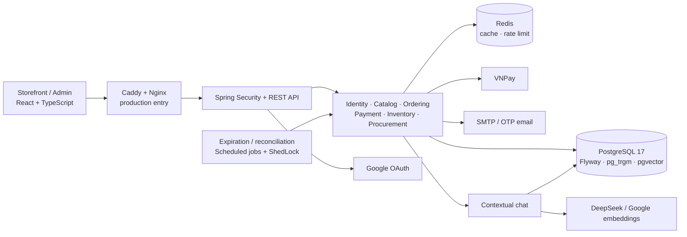
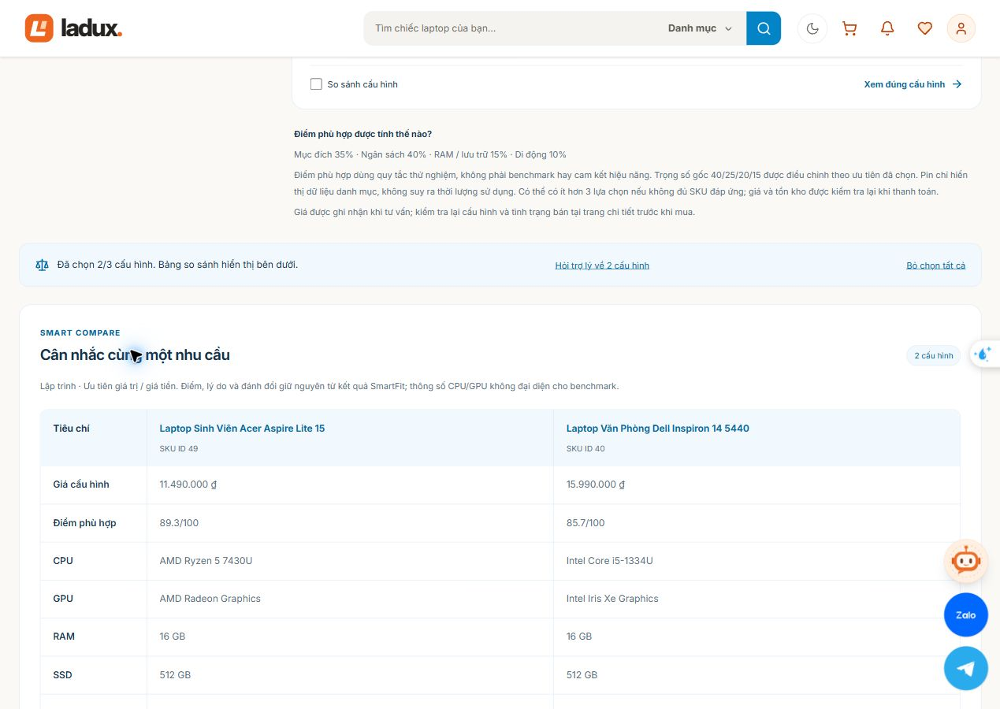
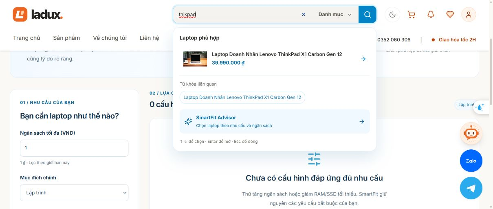
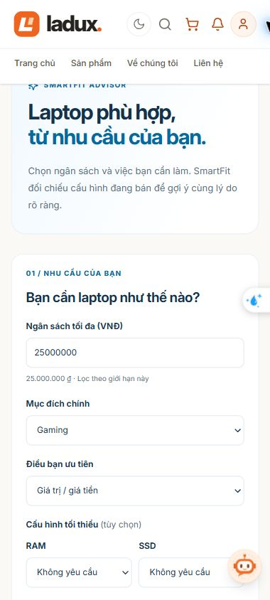

<div align="center">

# Ladux

### Thương mại điện tử laptop — từ lựa chọn cấu hình đến đối soát thanh toán

Một dự án cá nhân full-stack, tập trung vào tính đúng đắn của **đơn hàng, tồn kho và dòng tiền**.

[](https://github.com/phananhkhang/Ladux/actions/workflows/ci.yml)
[](backend/pom.xml)
[](backend/pom.xml)
[](frontend/package.json)
[](compose.yaml)

[Chạy dự án](docs/LOCAL_SETUP.md) · [Kiến trúc](backend/docs/architecture/README.md) · [Các quyết định kỹ thuật](docs/ENGINEERING.md) · [Tài liệu](docs/README.md)

</div>



*Ảnh chụp từ ứng dụng trong quá trình phát triển. Giá, dữ liệu mẫu và một số chi tiết giao diện có thể khác phiên bản hiện tại.*

## Ladux giải quyết điều gì?

Một lượt mua laptop kéo theo nhiều quyết định: chọn đúng cấu hình RAM/SSD, áp dụng ưu đãi, giữ hàng, chờ kết quả thanh toán, giao hàng và có thể trả hoặc hoàn tiền. Các bước này phải nhất quán ngay cả khi nhiều người mua cùng lúc hoặc cổng thanh toán phản hồi chậm.

Ladux mô hình hóa cả hành trình đó trong một hệ thống:

- **Người mua** tìm, so sánh và đặt đúng biến thể sản phẩm; theo dõi đơn và yêu cầu trả hàng.
- **Quản trị viên** xử lý đơn, ghi nhận thu tiền COD, đối soát VNPay và hoàn tiền có chứng từ.
- **Vận hành kho** quản lý nhà cung cấp, nhập hàng từng phần và truy vết biến động tồn kho.

**Trọng tâm kỹ thuật:** backend quyết định giá và tồn kho; mỗi thay đổi tiền/hàng đi qua quy tắc nghiệp vụ và transaction; kết quả từ bên ngoài phải được xác minh trước khi thay đổi trạng thái tài chính.

## Xem nhanh trong 3 phút

| Muốn hiểu | Bắt đầu ở đâu |
| --- | --- |
| Sản phẩm hoạt động thế nào | [Walkthrough SmartFit và so sánh](docs/media/smartfit-walkthrough.mp4), [ảnh giao diện](#giao-diện) |
| Tại sao dự án có chiều sâu backend | [5 bài toán kỹ thuật bên dưới](#những-bài-toán-kỹ-thuật-chính), [engineering notes](docs/ENGINEERING.md) |
| Code và test nằm ở đâu | [Bản đồ module](backend/docs/architecture/README.md), [CI](.github/workflows/ci.yml) |
| Tự chạy và khám phá | [Hướng dẫn local](docs/LOCAL_SETUP.md) |
| Đã kiểm chứng tới đâu | [Trạng thái và bằng chứng](docs/PROJECT_STATUS.md) |

Video hiện có là walkthrough dựng từ ảnh chụp, dài khoảng 2 phút 30 giây; không phải bản ghi thao tác trực tiếp.

## Phạm vi chức năng

| Phân hệ | Hành vi chính |
| --- | --- |
| **Catalog & discovery** | Tìm kiếm gần đúng bằng `pg_trgm`, lọc/sắp xếp/phân trang tại server, cấu hình theo SKU, đánh giá và danh sách yêu thích |
| **SmartFit & compare** | Lọc theo ngân sách/nhu cầu/RAM/SSD; xếp hạng có lý do và đánh đổi; so sánh đúng 2–3 cấu hình đã chọn |
| **Checkout & promotion** | Giỏ hàng, coupon, phí giao hàng; tính lại giá live, snapshot dòng đơn và đối chiếu tổng khách đã xác nhận |
| **Order operations** | Máy trạng thái đơn hàng, tracking, hết hạn thanh toán, hủy/trả hàng và lịch sử thao tác |
| **Payment & reconciliation** | COD, VNPay Sandbox, IPN, QueryDR, retry có kiểm soát, xử lý tiền đến muộn và hoàn toàn bộ payment |
| **Inventory & procurement** | Giữ/hoàn kho, điều chỉnh có sổ cái, đơn nhập và nhận hàng từng phần |
| **Identity & customer** | Tài khoản, Google OAuth, OTP email, địa chỉ, điểm/hạng khách hàng, phân quyền khách/admin |
| **Contextual assistant** | Thẻ sản phẩm do backend xác thực; LLM diễn giải theo ngữ cảnh; hiển thị Markdown và có phản hồi dự phòng khi provider lỗi |

## Những bài toán kỹ thuật chính

### 1. Hai người cùng mua chiếc laptop cuối cùng

Đọc tồn kho rồi trừ trong Java có thể cho cả hai request thấy cùng một số lượng. Ladux trừ kho bằng **UPDATE có điều kiện**, kiểm tra số dòng bị ảnh hưởng và giữ ràng buộc không âm tại PostgreSQL.

Checkout chạy trong một transaction: khóa giỏ hàng, xử lý SKU theo thứ tự ổn định, lấy giá hiện tại, dùng coupon, tạo order/payment, ghi sổ kho rồi dọn giỏ. Nếu client gửi `expectedAmount` và tổng tiền không khớp, hoặc bất kỳ bước bắt buộc nào thất bại, toàn bộ giao dịch rollback. UPDATE vẫn giữ row lock tới khi transaction kết thúc; thứ tự khóa giúp giảm nguy cơ deadlock.

→ [Code checkout](backend/src/main/java/org/akira/ladux/ordering/service/impl/OrderServiceImpl.java) · [Code giữ kho](backend/src/main/java/org/akira/ladux/inventory/service/impl/InventoryServiceImpl.java) · [Test tranh chấp](backend/src/test/java/org/akira/ladux/ordering/service/InventoryConcurrencyIntegrationTest.java)

### 2. Trình duyệt báo thành công nhưng server chưa nhận được tiền

Return URL là dữ liệu trình duyệt mang về. Ladux chỉ cập nhật thanh toán từ **IPN hoặc QueryDR đã xác minh** chữ ký, merchant, mã tham chiếu và số tiền. Settlement khóa order trước payment và xử lý callback lặp theo trạng thái đã lưu.

Một worker tìm giao dịch còn chờ để khôi phục kết quả khi mất IPN hoặc khách đóng trình duyệt. Tiền đến sau khi đơn đã hủy được ghi nhận để đối soát; hệ thống giữ nguyên việc hoàn kho đã xảy ra.

→ [Settlement](backend/src/main/java/org/akira/ladux/payment/service/impl/VNPaySettlementService.java) · [Test HTTP/gateway flow](backend/src/test/java/org/akira/ladux/payment/controller/VNPayFlowIntegrationTest.java) · [Luồng VNPay](docs/VNPAY_FLOW.md)

### 3. Gửi yêu cầu hoàn tiền rồi mất kết nối

Timeout không chứng minh rằng gateway chưa hoàn tiền. Ladux lưu refund attempt trước khi gọi gateway, thực hiện HTTP ngoài transaction giữ khóa DB, rồi hoàn tất trạng thái trong transaction riêng khi có bằng chứng xác minh.

Kết quả chưa rõ được giữ để review; có thao tác xác nhận đối soát bằng chứng từ thay vì tự gửi lại yêu cầu. Guard áp dụng theo từng payment để xử lý cả trường hợp một đơn nhận nhiều khoản thanh toán.

→ [Refund workflow](backend/src/main/java/org/akira/ladux/payment/service/RefundWorkflowService.java) · [Quyết định và trade-off](docs/ENGINEERING.md#3-hoàn-tiền-và-trạng-thái-chưa-rõ)

### 4. Đổi tài khoản trong khi request cũ vẫn đang chạy

Access token được giữ trong bộ nhớ; refresh token nằm trong cookie HttpOnly và được băm/xoay vòng ở backend. Storefront và admin có vùng phiên riêng. Frontend gắn phiên vào request để loại response hoặc refresh đã thuộc tài khoản cũ.

Backend kiểm tra token version để thu hồi access token khi cần, đồng thời áp dụng rate limit phân tán qua Redis/Bucket4j và kiểm tra quyền ở cả endpoint lẫn nghiệp vụ sở hữu dữ liệu.

→ [Test cách ly phiên](frontend/src/services/sessionIsolation.test.ts) · [JWT filter](backend/src/main/java/org/akira/ladux/identity/security/JwtFilter.java)

### 5. Tư vấn thông minh nhưng vẫn giữ dữ liệu bán hàng đáng tin cậy

Smart Search dùng truy vấn PostgreSQL; SmartFit dùng lọc và ranking có thể giải thích. Hai luồng này không cần gọi LLM. Với contextual chat, catalog xác thực lại SKU, giá và tồn kho trước khi dựng thẻ sản phẩm; LLM nhận nhiệm vụ diễn giải.

Các giới hạn được thể hiện rõ: SmartFit xét tối đa 500 SKU ứng viên; điểm phù hợp là heuristic, không phải benchmark phần cứng; thông số thiếu được giữ là “Chưa đủ dữ liệu”.

→ [SmartFit service](backend/src/main/java/org/akira/ladux/assistant/service/SmartFitService.java) · [Hợp đồng API và ranking](docs/SMARTFIT_GUIDE.md)

## Kiến trúc

**Một Spring Boot monolith chia module nghiệp vụ**, một PostgreSQL và một Redis. Mỗi module đi theo `controller → service → repository`, có DTO/mapper và entity tương ứng. Giao dịch liên quan order, kho, coupon và payment được xử lý trong cùng database.



Sơ đồ thể hiện bố trí production dự kiến. Local Compose mở frontend và backend trực tiếp; xem [cấu hình và cách chạy](docs/LOCAL_SETUP.md). Module là ranh giới tổ chức code, cùng chia sẻ transaction/database; chưa phải các service triển khai độc lập.

| Thành phần | Công nghệ |
| --- | --- |
| Backend | Java 21, Spring Boot 4.0.9, Spring Security, Spring Data JPA |
| Data & concurrency | PostgreSQL 17/pgvector, Flyway, Redis, Bucket4j, ShedLock |
| Frontend | React 18, TypeScript, Vite, Tailwind CSS, Zustand, TanStack Query |
| Assistant | Spring AI, DeepSeek, Google GenAI embeddings, pgvector |
| Verification | JUnit, Mockito, Testcontainers, ArchUnit, Vitest, GitHub Actions |
| Packaging | Docker Compose, Nginx, Caddy |

Xem [bản đồ module, trách nhiệm và quy tắc phụ thuộc](backend/docs/architecture/README.md), [sơ đồ dữ liệu](database/ladux_erd.png) và [lịch sử migration trong source](backend/src/main/resources/db). ERD là tài liệu tham khảo; Flyway là nguồn xác định schema hiện tại.

## Chạy local

Cần **Docker Engine/Desktop và Docker Compose v2**. Để chạy test ngoài container, cần thêm **JDK 21, Maven 3.9+ và Node.js 22+**.

```bash
git clone https://github.com/phananhkhang/Ladux.git
cd Ladux
cp .env.example .env
cp backend/.env.example backend/.env
```

Điền mật khẩu DB giống nhau ở hai file và sinh `JWT_SECRET` theo [hướng dẫn cấu hình](docs/LOCAL_SETUP.md#2-chuẩn-bị-cấu-hình). Template dùng credential giả cho các dịch vụ tùy chọn; thay bằng credential của bạn để thử OAuth, email, VNPay hoặc AI.

```bash
docker compose up -d --build --wait --wait-timeout 300
```

| Điểm vào | URL local |
| --- | --- |
| Storefront | http://localhost:5173 |
| Admin portal | http://localhost:5173/admin |
| Swagger UI — profile dev | http://localhost:8080/swagger-ui.html |
| Readiness | http://localhost:8080/actuator/health/readiness |

[Hướng dẫn đầy đủ](docs/LOCAL_SETUP.md) gồm PowerShell, tài khoản demo trên database mới, Vite hot reload và cách xử lý lỗi cấu hình. Không cần dùng cấu hình production để khám phá dự án local.

## Kiểm thử và bằng chứng

Snapshot ngày **27/10/2026**: backend **227 tests**, frontend **57 tests / 14 files**, thêm **13 tests** cho preflight/VNPay diagnostics. Các gate test, build và dependency audit đã đạt trên [CI của source snapshot](https://github.com/phananhkhang/Ladux/actions/runs/40384064685). Badge phía trên phản ánh lần chạy mới nhất.

```bash
# Từ thư mục gốc; Docker phải đang chạy cho Testcontainers.
mvn -B -f backend/pom.xml clean verify

cd frontend
npm ci
npm run check
cd ..

node --test scripts/preflight.test.mjs scripts/check-vnpay.test.mjs
```

Test tích hợp dùng PostgreSQL và Redis riêng, bao phủ tranh chấp SKU cuối, rollback checkout, hủy lặp, callback VNPay đồng thời, refund, migration mới/nâng cấp và quyền truy cập. ArchUnit kiểm tra ranh giới tầng/module; Vitest kiểm tra logic frontend, phiên và các thành phần liên quan. Đây chưa phải bộ kiểm thử trình duyệt end-to-end toàn hệ thống.

[Trạng thái kiểm chứng, giới hạn và điều kiện triển khai](docs/PROJECT_STATUS.md) được ghi riêng để phân biệt kết quả CI, smoke test fixture và tích hợp dịch vụ thật.

## Giao diện

| SmartFit — nhập nhu cầu | Smart Compare — đúng cấu hình |
| --- | --- |
|  |  |

| Tìm kiếm gần đúng | Trải nghiệm mobile |
| --- | --- |
|  |  |

[Chat theo ngữ cảnh](docs/media/contextual-chat.jpg) · [Chi tiết chọn đúng SKU](docs/media/smartfit-sku-detail.jpg) · [Trạng thái không có kết quả phù hợp](docs/media/smartfit-empty.jpg)

## Trạng thái dự án

**Đóng băng phạm vi tính năng từ 27/10/2026**, giữ làm portfolio và nền tảng để ôn lại thiết kế trước phỏng vấn. Bản snapshot có đầy đủ luồng demo và CI; phát triển tính năng mới tạm dừng.

Cấu hình triển khai production và runbook đã có. Trước khi vận hành bán hàng thật vẫn cần domain/HTTPS, credential đúng môi trường, kiểm chứng OAuth/CAPTCHA/SMTP/VNPay, backup ngoài host, cảnh báo và đo tải. Credential Sandbox hoặc kết quả CI không thay thế các điều kiện đó. Xem [runbook](docs/PRODUCTION_RUNBOOK.md).

## Tài liệu

- [Bắt đầu và chạy local](docs/LOCAL_SETUP.md)
- [Thiết kế nghiệp vụ, transaction và trade-off](docs/ENGINEERING.md)
- [Kiến trúc và bản đồ code](backend/docs/architecture/README.md)
- [SmartFit, discovery và contextual chat](docs/SMARTFIT_GUIDE.md)
- [Luồng VNPay](docs/VNPAY_FLOW.md) · [cấu hình và troubleshooting](docs/VNPAY_SETUP.md)
- [Frontend](frontend/README.md) · [trạng thái snapshot](docs/PROJECT_STATUS.md)
- [Triển khai và vận hành](docs/PRODUCTION_RUNBOOK.md) · [toàn bộ tài liệu và audit lịch sử](docs/README.md)

## Tác giả

**Phan Anh Khang** — định hướng Java Backend Developer.

[GitHub](https://github.com/phananhkhang) · [phananhkhang0603@gmail.com](mailto:phananhkhang0603@gmail.com)
