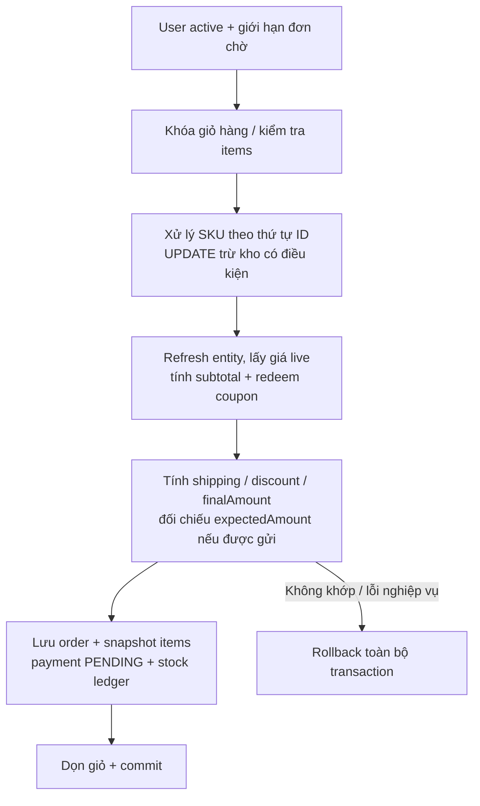
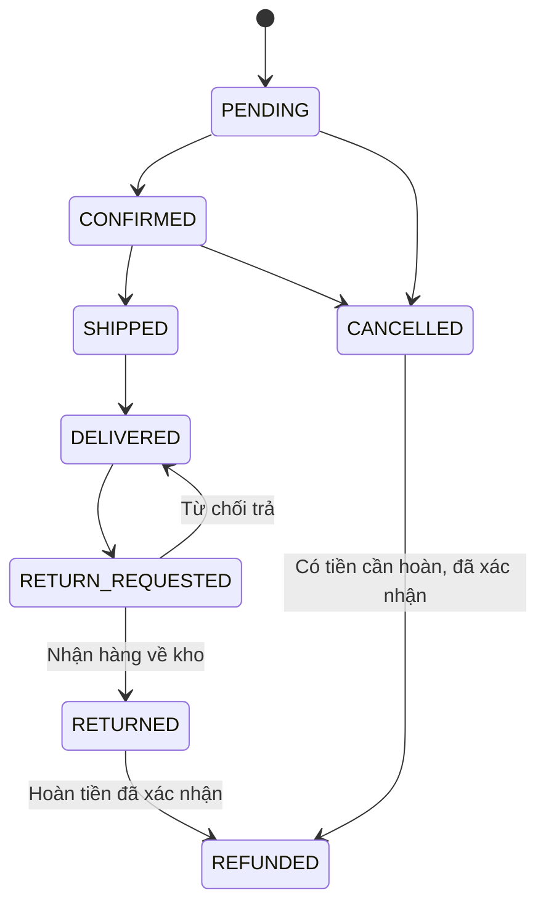

# Engineering notes — giữ đúng hàng, đơn và tiền

Tài liệu giải thích các quyết định quan trọng của Ladux ở snapshot portfolio. [Bản đồ module](../backend/docs/architecture/README.md) chỉ vị trí code; [Project status](PROJECT_STATUS.md) ghi những gì đã và chưa được kiểm chứng.

## 1. Checkout là một đơn vị giao dịch

**Tình huống:** hai người cùng mua SKU cuối; một coupon hết lượt ngay lúc checkout; hoặc giá sản phẩm đổi sau khi người mua đã xem giỏ.

Luồng `OrderServiceImpl.createOrder`:



Các lỗi ở bước ghi bắt buộc cũng rollback; nhánh lỗi trong hình chỉ minh họa trường hợp tổng tiền thay đổi.

### Atomic update và lock

Truy vấn thực tế kiểm tra SKU, product/category active, số lượng dương và đủ tồn kho; đồng thời tăng `version`. Phần cốt lõi có thể biểu diễn bằng SQL rút gọn:

```sql
UPDATE product_variants
SET stock_quantity = stock_quantity - :qty,
    version = version + 1
WHERE id = :sku_id
  AND :qty > 0
  AND stock_quantity >= :qty;
```

`rowsAffected = 0` khiến checkout thất bại. CHECK không âm ở DB là một lớp bảo vệ bổ sung. Sau bulk update, service refresh entity vì giỏ có thể đã load cùng SKU trước đó; giá và entity cũ không được dùng để ghi đè kết quả cập nhật mới.

Atomic UPDATE vẫn lấy row lock tới cuối transaction. Những luồng có nhiều SKU xử lý theo thứ tự ổn định để giảm chu trình khóa. Các thao tác quản trị/nhận hàng còn dùng pessimistic lock và optimistic version khi phù hợp; không có tuyên bố rằng toàn hệ thống là lock-free.

**Trade-off:** một transaction giữ connection trong suốt checkout, nhưng đổi lại rollback được kho, coupon và đơn như một khối. Các bước này chưa được chuyển sang queue/eventual consistency vì monolith cùng DB cho phép kiểm soát invariant trực tiếp.

**Bằng chứng:** [Order service](../backend/src/main/java/org/akira/ladux/ordering/service/impl/OrderServiceImpl.java), [Inventory service](../backend/src/main/java/org/akira/ladux/inventory/service/impl/InventoryServiceImpl.java), [repository update](../backend/src/main/java/org/akira/ladux/catalog/repository/ProductVariantRepository.java), [test concurrency](../backend/src/test/java/org/akira/ladux/ordering/service/InventoryConcurrencyIntegrationTest.java), [test rollback checkout](../backend/src/test/java/org/akira/ladux/ordering/service/OrderServiceTest.java).

## 2. Order status và payment status có trách nhiệm riêng



Sơ đồ chỉ biểu diễn các nhánh chính; không phải mọi mũi tên đều được phép qua cùng một endpoint. Trả hàng, refund và hủy có service chuyên trách cùng các guard theo payment/trạng thái/chủ sở hữu.

- VNPay chưa có khoản thanh toán hợp lệ thì không được xác nhận/xuất hàng như đơn đã trả tiền.
- COD có thể xác nhận và đang giao khi payment còn chờ; phải ghi nhận đã thu tiền bằng chứng từ trước khi chuyển `DELIVERED`.
- Hủy/expired order hoàn kho và lượt coupon trong transaction; việc hủy lặp không được hoàn hai lần.
- Nhận hàng trả cập nhật kho; refund xử lý dòng tiền. Hai việc có lịch sử và điều kiện khác nhau.
- Từ chối yêu cầu trả hàng đưa đơn về `DELIVERED`; không tính lại doanh số/điểm như một lần giao mới.

**Với VNPay:** Return chỉ kiểm tra dữ liệu hiển thị. IPN và QueryDR đã xác minh dùng chung settlement, luôn khóa order trước payment. Tiền đến muộn hoặc khoản trả trùng được giữ lại làm bằng chứng và gắn cờ review; không tái tạo tồn kho/đơn đã hủy.

ShedLock giảm việc job chạy đồng thời trên nhiều instance; transaction và guard DB vẫn là cơ chế giữ tính đúng đắn khi job/callback cạnh tranh. [Luồng VNPay](VNPAY_FLOW.md) mô tả đầy đủ.

**Bằng chứng:** [State machine](../backend/src/main/java/org/akira/ladux/ordering/service/impl/OrderStateMachineImpl.java), [lifecycle](../backend/src/main/java/org/akira/ladux/ordering/service/impl/OrderLifecycleServiceImpl.java), [settlement](../backend/src/main/java/org/akira/ladux/payment/service/impl/VNPaySettlementService.java), [test VNPay](../backend/src/test/java/org/akira/ladux/payment/controller/VNPayFlowIntegrationTest.java), [test expiration](../backend/src/test/java/org/akira/ladux/ordering/service/OrderExpirationJobTest.java).

## 3. Hoàn tiền và trạng thái chưa rõ

**Tình huống:** gateway đã nhận refund nhưng response bị mất. Gửi lại ngay có thể tạo thêm một yêu cầu hoàn; đánh dấu thất bại ngay làm mất thông tin cần đối soát.

Ladux chia quy trình thành các bước có ranh giới rõ:

1. Khóa và kiểm tra order/payment; tạo refund attempt bền vững trước khi gọi ngoài.
2. Gọi gateway ngoài transaction giữ DB lock; giới hạn timeout.
3. Xác minh phản hồi và cập nhật kết quả trong transaction riêng.
4. Nếu chưa đủ bằng chứng, giữ `PROCESSING`/`REVIEW_REQUIRED` và chuyển sang xử lý đối soát.

Guard là **theo payment**. Một đơn có thể nhận nhiều khoản tiền, nên hoàn khoản thừa không được vô tình đóng một đơn vẫn được giao hợp lệ. Khi xác nhận hoàn thủ công, mã chứng từ là bằng chứng cho tiền đã hoàn; endpoint không tự thực hiện chuyển khoản ngân hàng.

**Trade-off:** hệ thống chưa tự giải quyết mọi trạng thái chưa rõ. Nó ưu tiên giữ bằng chứng và yêu cầu người vận hành xác minh, thay vì giả lập cam kết exactly-once xuyên qua mạng/gateway. Chưa hỗ trợ partial refund.

**Bằng chứng:** [Refund workflow](../backend/src/main/java/org/akira/ladux/payment/service/RefundWorkflowService.java), [refund entity](../backend/src/main/java/org/akira/ladux/payment/entity/RefundAttempt.java), [migration guard theo payment](../backend/src/main/resources/db/migration/V58__refund_per_payment_and_resolution.sql), [test refund](../backend/src/test/java/org/akira/ladux/payment/service/RefundWorkflowServiceTest.java).

## 4. Phiên đăng nhập và quyền sở hữu dữ liệu

Access JWT ngắn hạn nằm trong memory frontend. Refresh token là opaque token; DB lưu hash, cookie HttpOnly giữ token gửi cho trình duyệt. Khi rotate, token cũ được đánh dấu đã dùng và token mới kế thừa family; phát hiện reuse dẫn tới thu hồi family và tăng token version.

JWT filter đọc user/role/trạng thái hiện tại và so token version trước khi cấp authentication. Việc thu hồi access token có thêm DB lookup trên request; đây là trade-off để cập nhật quyền/khóa tài khoản có tác dụng ngay khi request tiếp theo được kiểm tra.

Storefront và admin dùng access-token memory/refresh cookie riêng. Frontend ghi session epoch vào request, loại response cũ khi đổi tài khoản và không khôi phục token từ một refresh đã thuộc phiên cũ. Quyền sở hữu order/payment vẫn kiểm tra ở backend; ẩn nút trên UI không thay thế authorization.

OAuth dùng filter chain và HTTP session tạm riêng để giữ authorization request/state; REST chain stateless và không dùng OAuth session để xác thực API. CAPTCHA/rate limit là lớp bảo vệ đăng nhập; production yêu cầu HTTPS và secure cookie.

**Bằng chứng:** [Security config](../backend/src/main/java/org/akira/ladux/identity/config/SecurityConfig.java), [refresh rotation](../backend/src/main/java/org/akira/ladux/identity/service/impl/RefreshTokenServiceImpl.java), [JWT filter](../backend/src/main/java/org/akira/ladux/identity/security/JwtFilter.java), [session isolation tests](../frontend/src/services/sessionIsolation.test.ts).

## 5. Đọc catalog, cache và dữ liệu gợi ý

Catalog lọc/sort/page ở server; thông số kết hợp phải khớp cùng một SKU. Truy vấn danh sách dùng pattern lấy page ID rồi fetch dữ liệu tương ứng, giữ thứ tự trang và tránh phân trang trên collection fetch join. DTO summary giảm dữ liệu trên trang danh sách; detail tải riêng theo ID.

Spring Cache có TTL, key bao gồm sort và namespace `ladux:modules:v2:`. Invalidation được phối hợp với commit. Tuy vậy nhiều đường ghi vẫn clear toàn cache và cache/rate limit dùng cùng Redis; khi tăng tải cần đo cache miss, Redis latency và eviction của bucket bảo mật.

SmartFit đọc catalog live, xếp hạng heuristic theo ưu tiên và trả lý do/đánh đổi. Contextual chat chỉ dựng product card từ SKU còn hợp lệ; semantic retrieval cung cấp ứng viên chứ không quyết định giá bán. Markdown phía frontend xử lý câu trả lời với raw HTML bị bỏ qua và URL được kiểm soát.

**Trade-off:** RAM/ROM là dữ liệu chưa hoàn toàn chuẩn hóa; SmartFit giới hạn 500 ứng viên trước bước parse và chưa chứng minh tối ưu toàn catalog lớn. Embedding/index-all còn đồng bộ trong transaction; đây là một điểm cần batch/job nếu tiếp tục mở rộng.

**Bằng chứng:** [Catalog query](../backend/src/main/java/org/akira/ladux/catalog/service/CatalogQueryService.java), [Redis cache config](../backend/src/main/java/org/akira/ladux/shared/config/RedisCacheConfig.java), [SmartFit guide](SMARTFIT_GUIDE.md), [Markdown renderer](../frontend/src/components/common/ChatbotMessage.tsx).

## 6. Vì sao chọn monolith chia module?

Checkout, kho, coupon và payment cần phối hợp chặt. Một Spring Boot application với một PostgreSQL cho phép giữ transaction rõ và triển khai/debug bằng một stack nhỏ. Module tách theo nơi sở hữu nghiệp vụ; ArchUnit bảo vệ các tầng và ngăn controller truy cập repository/JPA/JDBC.

Các entity/repository còn liên kết chéo module; ranh giới chưa đủ để tách service độc lập mà không thiết kế lại transaction và hợp đồng dữ liệu. Đổi sang microservices sẽ kéo theo orchestration, bù trừ và vận hành phân tán; phạm vi portfolio này chưa cần chi phí đó.

Khi quay lại dự án, bắt đầu từ điều kiện nghiệp vụ và bằng chứng test của một thay đổi. Không thêm queue, cache hoặc service mới chỉ để tăng số công nghệ trong sơ đồ.
